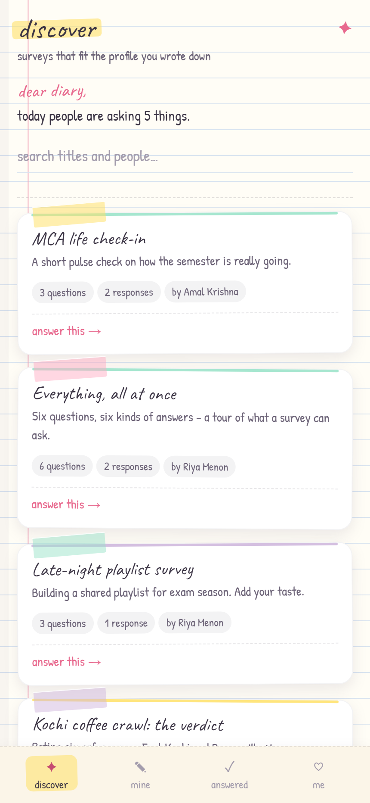
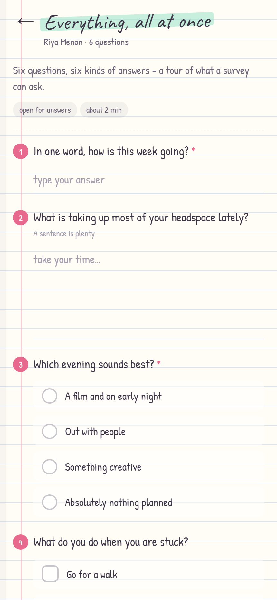
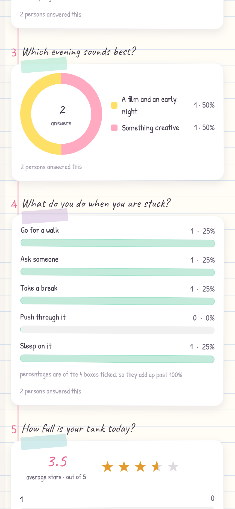

# DataScope

A survey platform that looks like a school notebook and behaves like a proper tool:
highlighter marks, washi tape, handwritten headings — and underneath, JWT auth, a
schema-validated Express API, six question types, and a results dashboard drawn from
real aggregation.

Built as one Expo codebase that runs on iOS, Android and the web, against an
Express + MongoDB API.

| Discover | Answer | Results |
| --- | --- | --- |
|  |  |  |

## What it does

- **Accounts** — register, sign in, edit a profile (age, city, occupation, interests).
- **A builder** — six question types: short answer, long answer, pick one, pick any,
  star rating, and a numeric scale. Reorder, rewrite, mark questions required, choose a
  highlighter colour for the survey.
- **Publishing and sharing** — a draft is private; publishing freezes the questions,
  opens a public link (`/s/<slug>`), and starts collecting answers.
- **Answering other people's surveys** — anyone with the link can read it; signing in
  lets them answer. The discover feed instead shows only open surveys that match the
  reader's profile and that they have not answered yet.
- **Results** — response counts, a 14-day timeline, donuts for single choice, bars for
  multi choice, averages and star distributions for ratings and scales, and the text
  answers themselves.

## Stack

| Part | Choice |
| --- | --- |
| Client | Expo SDK 58, React Native 0.88, React 19, Expo Router, TypeScript |
| Charts | `react-native-svg` donut + view-based bars (no charting library) |
| Server | Express 4, Mongoose 8, Zod, `tsx` (TypeScript, no build step) |
| Auth | `jsonwebtoken` + `bcryptjs`, bearer tokens |
| Database | MongoDB — local `mongod` in development, Atlas in production |

## Layout

```
DataScope/
├── server/                  Express API
│   ├── src/
│   │   ├── routes/          auth · user · survey · feed · public
│   │   ├── models/          User · Survey · Response
│   │   ├── services/        matcher · answers · results · surveyInput
│   │   ├── middleware/      auth · error handling
│   │   ├── db/              connection + local mongod bootstrap
│   │   ├── schemas.ts       every request body, in one place
│   │   └── seed.ts          demo accounts, surveys and responses
│   ├── tests/               unit tests for the pure services
│   └── scripts/smoke.mjs    end-to-end checks against a running API
├── app/                     Expo client (iOS · Android · web)
    ├── src/app/             routes (Expo Router, file-based)
    ├── src/components/      design-system pieces
    ├── src/lib/             API client, auth provider, helpers
    ├── src/theme/tokens.ts  colours, fonts, spacing, shadows — the whole look
    └── assets/fonts/        Caveat + Patrick Hand (committed, loaded at runtime)
```

Plus `docs/screenshots` for the images above, `render.yaml` for the one-service
Render deploy, and `DEPLOY.md` for the click-by-click path from empty accounts to
a live URL.

## Running it locally

You need Node 20+ and nothing else — no MongoDB installation, no admin rights.

```bash
# 1. install both halves
npm run install:all

# 2. fill the database with demo accounts, surveys and answers
npm run seed

# 3. terminal one: the API on http://localhost:4000
npm run dev:server

# 4. terminal two: the client
npm run dev:app          # then press "w" for web, or scan the QR code
```

Then open <http://localhost:8081>.

> **Windows blocking `esbuild.exe`?** Smart App Control (and some corporate
> Application Control policies) can quarantine it, and `tsx` — the server's dev
> runner — needs it. There is a transpiler-free path:
> `npm --prefix server run build && npm --prefix server run start:built`. It uses
> the same database, so nothing is lost. Allow the binary in Windows Security to
> get hot reload back.

### Demo accounts

All four use the password `password123`.

| Email | Who they are | Worth looking at |
| --- | --- | --- |
| `meera@datascope.dev` | 19, Kochi, art + music | The discover feed as a brand new account — five surveys |
| `amal@datascope.dev` | 22, Kochi, music + tech | Owns a draft and a published survey with answers |
| `riya@datascope.dev` | 21, Kochi, music + art | Owns "Everything, all at once" — all six question types |
| `arjun@datascope.dev` | 26, Bengaluru, tech + cricket | Owns a closed survey and a targeted one |

Signing in as Meera and opening **mine** is the fastest way to see the builder: create a
survey, publish it, then answer it from one of the other accounts.

### How the database works in development

With `MONGODB_URI` empty, the server starts a real `mongod` for you
(`mongodb-memory-server`) and keeps its files in `server/.mongo-data`, so stopping the
server does not lose anything.

One detail worth knowing: `mongodb-memory-server` only shuts a *replica set* down
gracefully. A standalone mongod — the one this app starts — would otherwise be killed,
and on Windows a killed mongod can lose the tail of its journal, i.e. your most recent
writes, without any error. `server/src/db/localMongo.ts` therefore sends mongod an
`admin.shutdown` command first, then lets the library reap it. `npm run seed` also reads
its own writes back and fails loudly if the counts are wrong, rather than printing a
hopeful summary.

To use Atlas or an installed MongoDB instead, set one variable and restart:

```bash
# server/.env
MONGODB_URI=<atlas-connection-string>
```

See `server/.env.example` for the rest.

## Tests

```bash
npm test                 # 31 unit tests: matching, answer validation, results maths
npm run typecheck        # server types

cd app
npx tsc --noEmit         # client types
npx expo lint
```

With the API running, there is also an end-to-end check of the whole surface — auth,
ownership, publishing, targeting, validation, submission, results and deletion:

```bash
cd server
npm run smoke            # 43 checks, leaves the database as it found it
```

## API

| Method | Path | What it does |
| --- | --- | --- |
| `POST` | `/api/auth/register` | Create an account |
| `POST` | `/api/auth/login` | Sign in, receive a bearer token |
| `GET` | `/api/auth/me` | The signed-in user |
| `PATCH` | `/api/user/me` | Update name and profile |
| `GET` | `/api/surveys` | The surveys you own |
| `POST` | `/api/surveys` | Create a draft |
| `GET` | `/api/surveys/:id` | One of your surveys, questions included |
| `PATCH` | `/api/surveys/:id` | Edit it (questions only while it is a draft) |
| `POST` | `/api/surveys/:id/publish` | Freeze the questions and open the link |
| `POST` | `/api/surveys/:id/close` | Stop accepting answers |
| `DELETE` | `/api/surveys/:id` | Delete the survey and its responses |
| `GET` | `/api/surveys/:id/results` | Aggregated results (owner only) |
| `GET` | `/api/feed` | Open surveys that match your profile and are unanswered |
| `GET` | `/api/feed/answered` | What you have filled in |
| `GET` | `/api/public/surveys/:slug` | The share-link page (no account needed) |
| `POST` | `/api/public/surveys/:slug/responses` | Submit an answer sheet |

## Design decisions

**Freezing questions on publish.** Answers are keyed to question and option ids, so
editing a live survey would silently corrupt results other people are already reading.
Title, description, colour and targeting stay editable.

**One response per person per survey**, enforced by a unique index on
`(survey, respondent)` rather than a check-then-insert.

**Targeting gates discovery, never access.** A share link always opens; the profile
rules only decide who finds a survey in their own feed. That is also why you can never
answer your own survey — the link shows it to you read-only.

**Matching lives in application code** (`services/matcher.ts`) over a bounded query,
because readable, unit-tested rules are worth more here than shaving a round trip.

**The client owns no styling shortcuts.** Every colour, font, radius, shadow and tilt
comes from `app/src/theme/tokens.ts`; screens do not hard-code values.

**No chart library.** A donut is one SVG circle per slice with a dash array; bars are
views. It is less code than configuring a charting dependency, and it matches the
hand-drawn look.

## Deploying (optional)

DataScope is a local-first project: the whole demo runs on one machine with
`npm run seed` and two dev servers, and that is the supported path. The
production mode below is built and tested locally — `render.yaml` and
[DEPLOY.md](DEPLOY.md) describe putting it on Render with MongoDB Atlas — but it
has not been verified against a live Render deploy.

In production one process runs the API *and* serves the built web client, so the
app lives on a single URL; the mechanics are:

```bash
npm --prefix app run build:web          # -> app/dist
NODE_ENV=production \
MONGODB_URI="<atlas-connection-string>" \
JWT_SECRET="…" \
npm --prefix server start               # API + client on one port
```

- **Web** — in production the server serves `app/dist` and falls back to
  `index.html` for client-side routes, so `/s/<slug>` deep links work.
- **API** — `NODE_ENV=production` refuses the development `JWT_SECRET`, requires
  `MONGODB_URI`, and never boots a local mongod. Use a long random `JWT_SECRET`.
- **Native** — `npx expo run:ios` / `run:android`, or an EAS build, pointed at the
  deployed API with `EXPO_PUBLIC_API_URL`.
- **Separate hosting** — you can host the web build and the API apart, but then the
  API needs `CORS_ORIGIN` and the client needs `EXPO_PUBLIC_API_URL`.

## Known trade-offs

- The token lives in `AsyncStorage` (localStorage on web). It is not encrypted at rest;
  `expo-secure-store` would be the upgrade for a production mobile build.
- Text answers are capped at 200 per question in the results view, with a note when
  there are more.
- The timeline covers 14 days.
